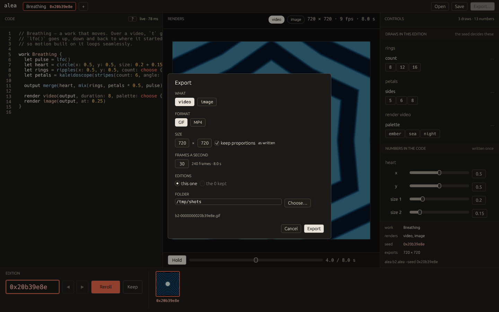
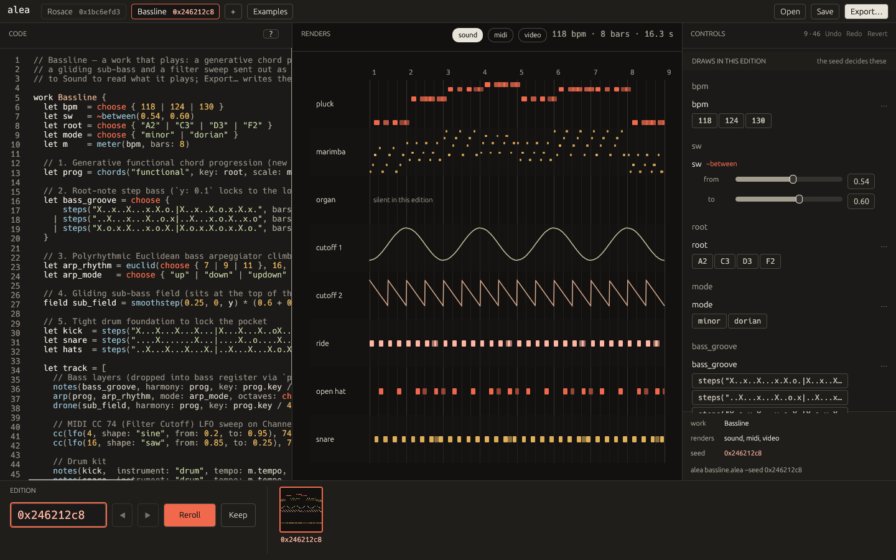
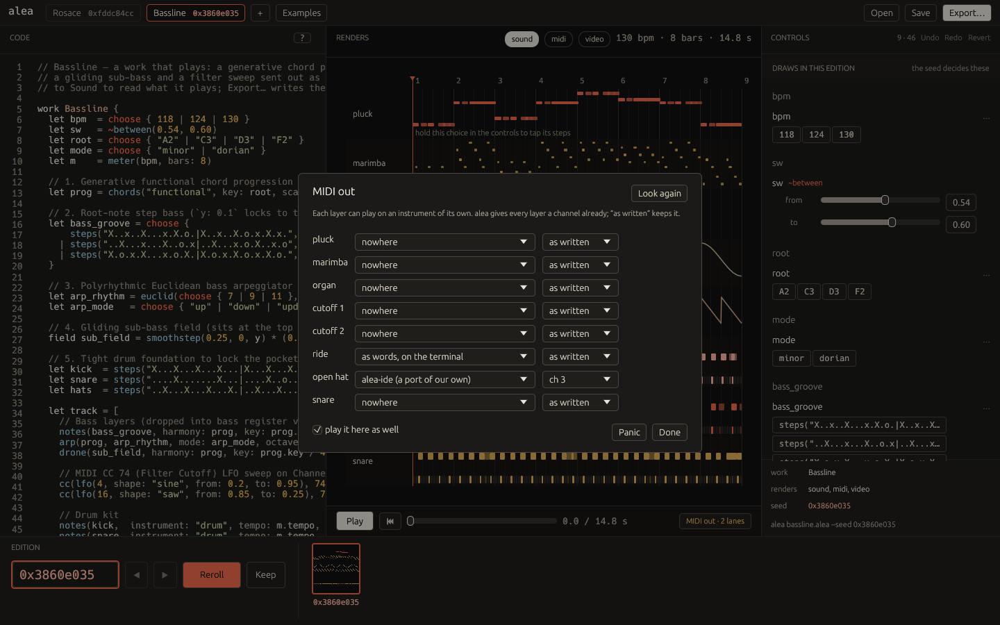
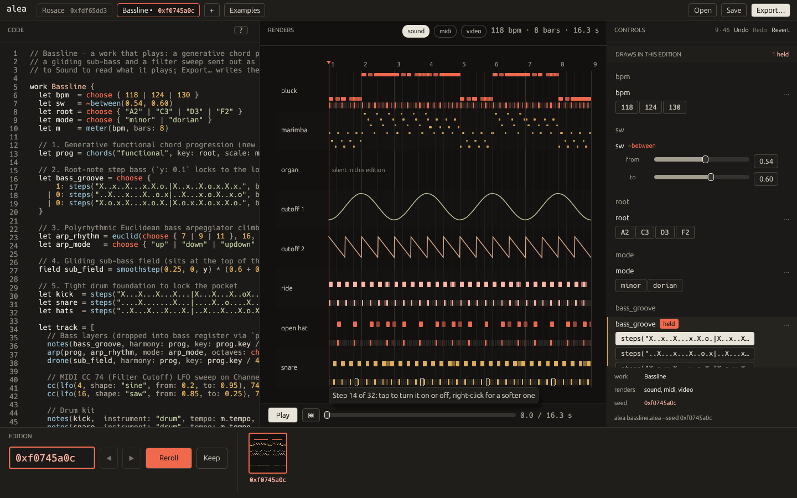
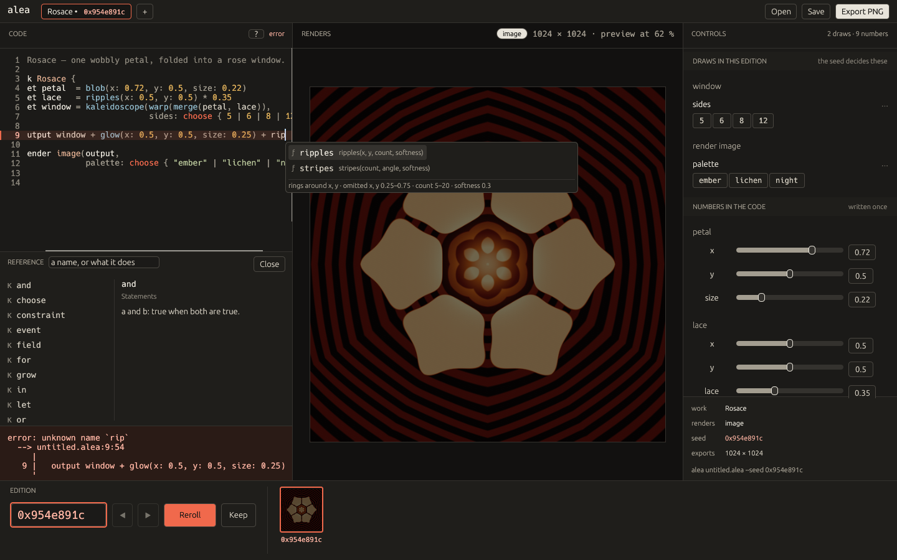
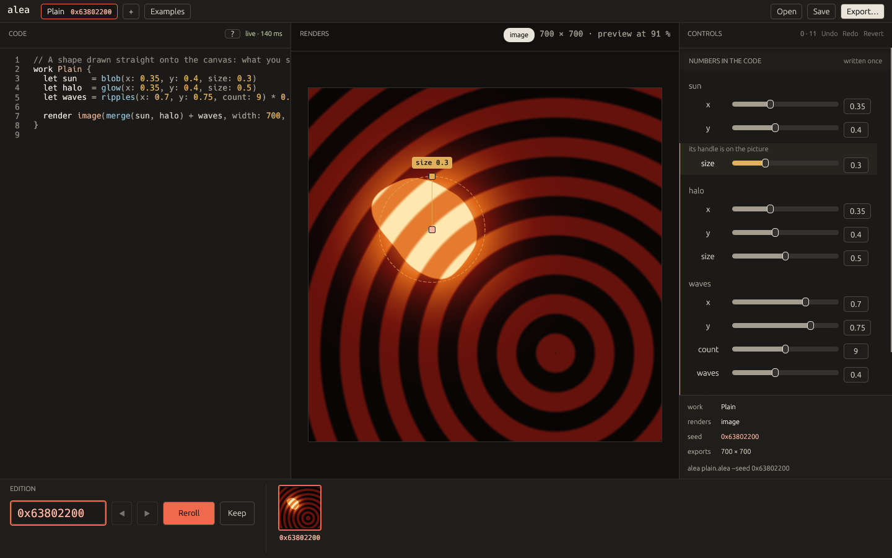

# alea IDE

A studio for [alea](https://github.com/sudo-bngz/alea), the language for
generative art. Write a work on the left, see its edition in the middle,
and reroll the seed until one is worth keeping.


> Status: early. It shows `render image`, `render video`, `render sound` and
> `render midi` works, and plays the ones that make sound. The sculpture
> viewport and drawing on the canvas are planned but not there yet.

## What it does

- **A tab is a work at a seed.** `+` opens the same work in a second tab at
  another seed; both tabs share the text.
- **Live preview.** The edition redraws as you type: a quick rough pass, then
  one at the size of the viewport. A mistake keeps the last good image,
  dimmed, and shows alea's own diagnostic under the code.
- **Reroll.** `Space` (when the code is not focused) or `Ctrl/Cmd+R` draws a
  new edition. The strip at the bottom remembers where the tab has been;
  click a thumbnail to go back, or type a seed to return to a known edition.
  Thumbnails drawn from older code are faded.
- **Keep.** Kept editions are never dropped from the history.
- **Export.** Opens a dialog: what to write, in which format, at which size,
  and for which editions. See below.

The same seed draws the same edition here and with `alea work.alea --seed N`.

## Export



**Export…** opens a dialog set to what the work asks for, and nothing is
written until you say so.

| Render | Formats | What you can set |
| --- | --- | --- |
| `image` | PNG, JPEG | size (proportions kept unless you say otherwise), JPEG quality |
| `video` | GIF, MP4 | size, frames a second (it says how many frames that makes) |
| `sound` | WAV | — |
| `midi` | MIDI | — |
| `sculpture` | STL | — |

Everything but the MP4 is written by the IDE itself, so nothing has to be
installed. An MP4 is handed to ffmpeg, as the command line does, with the
work's sound on it; without ffmpeg on the machine that one format is greyed
out and the rest still work.

**Editions**: this one, or every edition you marked *Keep* in this tab — one
file each, named by its seed, so a sheet of editions comes out in one go.
The line above the buttons says what will be written, and a bar says where
the run has got to.

## Music



A work that renders `sound` or `midi` lays its music out: a lane per layer,
the notes where they fall, and a knob's turns as a curve. The bar numbers
and the grid come from the work's own tempo.

Lanes are named after what plays them — `pluck`, `marimba`, and a drum lane
after the piece it strikes most, so three `drum` layers read as `kick`,
`snare` and `open hat`. Each lane is drawn against its own range of pitches,
so a bass line and a hi-hat are both worth looking at, and a note's weight
shows in how brightly it is drawn. A layer that plays nothing in this
edition says so rather than leaving an empty row.

The music is read from the same MIDI alea would send to a DAW, so what you
see here is what the work plays.

It plays it, too. The transport under the roll plays the loop, goes back to
the top and scrubs, and the bar numbers scrub it as well; a playhead sweeps
the lanes as it goes. The samples are rendered the way an export writes
them, so what is heard is what is written, and they are rendered in the
background: until they land, the transport says so. A new edition of the
same work slips in without stopping, so a knob can be turned — or a step
moved — while it plays.

### Out to the instruments



**MIDI out…**, under the roll, points each lane at an instrument of its
own, the way a DAW points a track at an output: a port on the machine, a
port of the studio's own that another program can read from (`alea-ide`),
or — with nothing to send to — the messages written out as words, the way
`alea --midi-port print` writes them. alea already gives every layer a
channel of its own; a lane can be given another one.

The messages are the ones `render midi` writes, so the instruments play
what the file would hold. They go out on a thread of its own, on time,
and a stop sends a note off for everything held and all-notes-off on
every channel played on — nothing is left hanging. **Panic** does that at
any moment. Moving a lane while it plays takes effect there and then, and
a new edition takes over where the one playing is.

With a lane sent out, the machine's own speakers stay quiet unless *play
it here as well* is ticked.

### Tapping out a pattern



A lane whose rhythm is written out as `steps("X..x")` carries a strip of
its own along the bottom: the pattern, step by step, as the work writes it.
Tap a step to turn it on or off, right-click to walk it down through alea's
weights — accent, note, ghost, silence. Each tap rewrites one character in
the string, so the roll and the code say the same thing, and `Ctrl/Cmd+Z`
takes it back like any other edit.

The pattern repeats over the work, so the hand on one step is on every turn
of it: hovering shows them all, and a tap moves them together. A rhythm the
work makes another way — `euclid`, a field, a chord progression — has
nothing written to tap. A `choose` between patterns is a choice the seed is
still making; hold it at one option in the controls and its steps are
written down, and tappable.

## Loops

A work that renders video plays in the viewport, on a loop. The chips at the
top of the viewport say what the work renders; click one to show it.

The loop is drawn frame by frame in the background, so the first picture
arrives long before the last, and it plays as soon as there is something to
play: a counter says how far along it is. It is drawn smaller and slower
than the work asks for — at most 384 pixels, 15 frames a second and 72
frames — so that a long loop stays a preview. Its length is the work's own,
and the transport underneath plays, holds and scrubs it.

**Export GIF** writes the loop as a GIF, which needs nothing installed: at
most 480 pixels, 15 frames a second and 120 frames, and the line it reports
says exactly what was written. For an MP4, with its sound and at full size,
run the work through the command line — `alea work.alea --seed N` — which
uses ffmpeg.

## The controls



Every `choose`, every `~` and every number of the work turns up in the pane
on the right — the draws the seed decides first, then the numbers written
once.

The code stays the truth. A control holds no value of its own: it reads one
out of the text and writes one back, so moving a slider and typing the
number yourself are the same edit, and the preview redraws either way.
Clicking the name of a control shows you the piece of code it owns.

- A **number** is a slider, with its value beside it to type into. The slider
  runs from 0 to 1 for a ratio and to twice its value otherwise, and holds
  that span until you let go, so one pull at most doubles a number; pull
  again, or type, to go further. A number keeps the shape it was written in: `80` stays whole,
  `0.015` keeps its three decimals.
- A **range** — `~between(0.5, 0.8)` — has a slider per end, which widens or
  narrows what the next edition may draw.
- A **handle on the picture.** Touch the control of an `x`, a `y` or a
  `size` and the shape it belongs to gets handles on the canvas: one to move
  it, one to make it wider, with a dashed ring around what it covers. The
  picture is the work's own canvas, so a handle lands where you put it.
  A shape that goes through `kaleidoscope`, `warp`, `mirror`, `move` or any
  other transform on its way to the picture is no longer drawn where its own
  numbers say, so it gets no handle and the control says which transform
  moved it.
- A **choice** — `choose { 5 | 6 | 8 }` — is a row of its options. Click one
  to **hold** the choice there: every edition draws that option until you
  click it again. The `…` button writes the options out instead, to change
  their text, take one out, or add one more.



**Undo** takes back the last step, whether it was typed, pulled or clicked —
it is all the same text — and **Revert** goes back to the work as it was
opened, or as it was last saved. A pull across the canvas is one step, not
fifty: changes stop joining a step after a pause, or after four seconds.

Holding is written in the work, in the language's own weights:
`choose { 0: 5 | 1: 6 | 0: 8 }`. Nothing is hidden in the editor, the held
option survives a save and a reopen, and letting go puts the line back as it
was. A choice the artist has weighted themselves is left alone.

## While you write

- **Names are offered as you type**: the work's own `let`s and parameters
  first, then the primitives, functions and forms of the language, with the
  signature and what the reference says about the selected one. `↑` `↓` to
  choose, `Enter` or `Tab` to take it, `Esc` to dismiss, `Ctrl/Cmd+Space` to
  ask for the list. Inside a `render`, its own options are offered
  (`palette:` in an image, `duration:` in a sound).
- **The reference is a key away.** `F1` opens it under the code, on the name
  the cursor is on, and it is searchable by name or by what something does.
  Resting the pointer on a name in the code shows the same card.

The reference is alea's own `docs/reference.md`, vendored here as
`assets/reference.md` and read at startup, so what the language documents is
what the IDE offers. `scripts/update-reference.sh ../alea` refreshes it.

## Run

Requires a Rust toolchain (1.95+). On Linux you also need the usual
windowing libraries (`libxkbcommon`, `libwayland`, `libgl`) and ALSA
(`libasound2-dev`) for the sound and MIDI output; macOS and Windows need nothing
beyond the toolchain.

```sh
cargo run --release                  # opens a starter work
cargo run --release -- rosace.alea   # or a file
```

Three works come with the IDE, under **Examples** in the top bar: `rosace`,
the still one the window opens on, `breathing`, which renders a video as
well as an image — the one to open to see a loop play — and `bassline`,
which plays: it opens on its roll, where it can be heard and its patterns
tapped out.

## Keys

| Key | Action |
| --- | --- |
| `Space` / `Ctrl/Cmd+R` | Reroll |
| `Ctrl/Cmd+[` / `]` | Previous / next edition |
| `Ctrl/Cmd+T` | This work in a new tab, at another seed |
| `Ctrl/Cmd+W` | Close tab |
| `Ctrl/Cmd+O` / `S` | Open / save |
| `Ctrl/Cmd+Z` | Undo |
| `Ctrl/Cmd+Shift+Z` | Redo |
| `Ctrl/Cmd+E` | Export |
| `Ctrl/Cmd+Space` | Offer names here |
| `F1` / `Ctrl/Cmd+K` | The reference |

## How it is built

- [`alea-lang`](https://github.com/sudo-bngz/alea) is the engine: the IDE
  parses the text on screen, resolves it at the tab's seed and paints the
  result (`src/engine.rs`, on a worker thread that always draws the latest
  request).
- [`qell-core`](https://github.com/sudo-bngz/qell) provides the alea syntax
  highlighting.
- The controls read the work's own syntax tree, keeping the slice of source
  each draw and number occupies (`src/draws.rs`), and write back into those
  slices.
- [egui](https://github.com/emilk/egui) draws the window (`src/app.rs`).

## Licence

MIT
