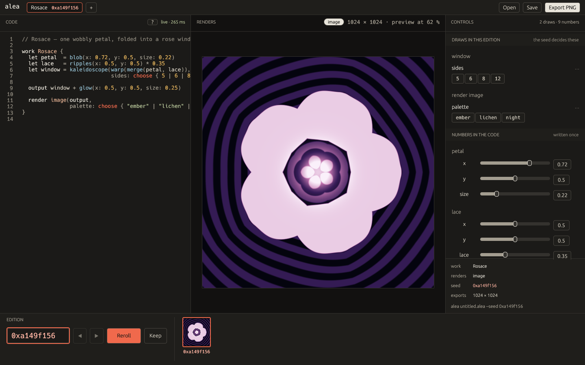

# alea IDE

A studio for [alea](https://github.com/sudo-bngz/alea), the language for
generative art. Write a work on the left, see its edition in the middle,
and reroll the seed until one is worth keeping.



> Status: early. It shows `render image` works. Sound, MIDI, video and
> sculpture viewports, and drawing on the canvas, are planned but not there
> yet.

## What it does

- **A tab is a work at a seed.** `+` opens the same work in a second tab at
  another seed; both tabs share the text.
- **Live preview.** The edition redraws as you type: a quick rough pass, then
  one at the size of the viewport. A mistake keeps the last good image,
  dimmed, and shows alea's own diagnostic under the code.
- **Reroll.** `Space` (when the code is not focused) or `Ctrl/Cmd+R` draws a
  new edition. The strip at the bottom remembers where the tab has been;
  click a thumbnail to go back, or type a seed to return to a known edition.
  Thumbnails drawn from older code are faded.
- **Keep.** Kept editions are never dropped from the history.
- **Export PNG.** Writes the edition on screen at the size the work asks
  for, named `<work>-<seed>.png` like the command line does.

The same seed draws the same edition here and with `alea work.alea --seed N`.

## The controls


Every `choose`, every `~` and every number of the work turns up in the pane
on the right — the draws the seed decides first, then the numbers written
once.

The code stays the truth. A control holds no value of its own: it reads one
out of the text and writes one back, so moving a slider and typing the
number yourself are the same edit, and the preview redraws either way.
Clicking the name of a control shows you the piece of code it owns.

- A **number** is a slider, with its value beside it to type into. The slider
  runs from 0 to 1 for a ratio and to twice its value otherwise; typing goes
  further. A number keeps the shape it was written in: `80` stays whole,
  `0.015` keeps its three decimals.
- A **range** — `~between(0.5, 0.8)` — has a slider per end, which widens or
  narrows what the next edition may draw.
- A **choice** — `choose { 5 | 6 | 8 }` — is a row of its options. Click one
  to **hold** the choice there: every edition draws that option until you
  click it again. The `…` button writes the options out instead, to change
  their text, take one out, or add one more.

Holding is written in the work, in the language's own weights:
`choose { 0: 5 | 1: 6 | 0: 8 }`. Nothing is hidden in the editor, the held
option survives a save and a reopen, and letting go puts the line back as it
was. A choice the artist has weighted themselves is left alone.

## While you write

- **Names are offered as you type**: the work's own `let`s and parameters
  first, then the primitives, functions and forms of the language, with the
  signature and what the reference says about the selected one. `↑` `↓` to
  choose, `Enter` or `Tab` to take it, `Esc` to dismiss, `Ctrl/Cmd+Space` to
  ask for the list. Inside a `render`, its own options are offered
  (`palette:` in an image, `duration:` in a sound).
- **The reference is a key away.** `F1` opens it under the code, on the name
  the cursor is on, and it is searchable by name or by what something does.
  Resting the pointer on a name in the code shows the same card.

The reference is alea's own `docs/reference.md`, vendored here as
`assets/reference.md` and read at startup, so what the language documents is
what the IDE offers. `scripts/update-reference.sh ../alea` refreshes it.

## Run

Requires a Rust toolchain (1.95+). On Linux you also need the usual
windowing libraries (`libxkbcommon`, `libwayland`, `libgl`).

```sh
cargo run --release                  # opens a starter work
cargo run --release -- rosace.alea   # or a file
```

## Keys

| Key | Action |
| --- | --- |
| `Space` / `Ctrl/Cmd+R` | Reroll |
| `Ctrl/Cmd+[` / `]` | Previous / next edition |
| `Ctrl/Cmd+T` | This work in a new tab, at another seed |
| `Ctrl/Cmd+W` | Close tab |
| `Ctrl/Cmd+O` / `S` | Open / save |
| `Ctrl/Cmd+E` | Export PNG |
| `Ctrl/Cmd+Space` | Offer names here |
| `F1` / `Ctrl/Cmd+K` | The reference |

## How it is built

- [`alea-lang`](https://github.com/sudo-bngz/alea) is the engine: the IDE
  parses the text on screen, resolves it at the tab's seed and paints the
  result (`src/engine.rs`, on a worker thread that always draws the latest
  request).
- [`qell-core`](https://github.com/sudo-bngz/qell) provides the alea syntax
  highlighting.
- The controls read the work's own syntax tree, keeping the slice of source
  each draw and number occupies (`src/draws.rs`), and write back into those
  slices.
- [egui](https://github.com/emilk/egui) draws the window (`src/app.rs`).

## Licence

MIT
